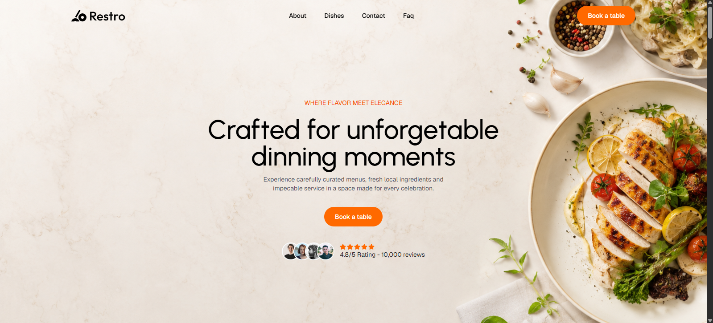
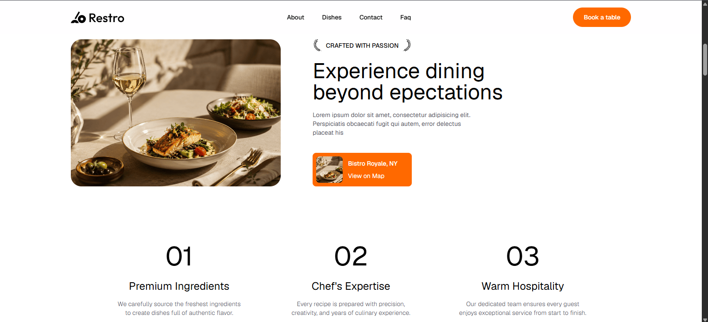
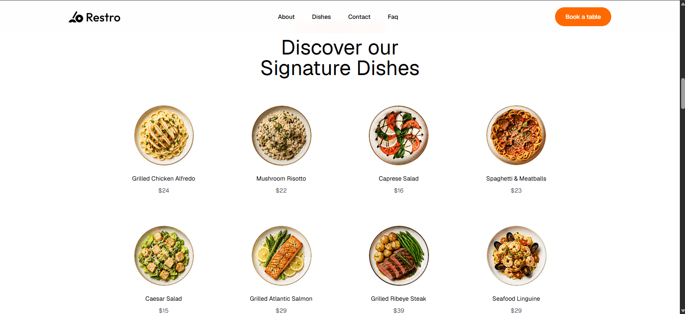
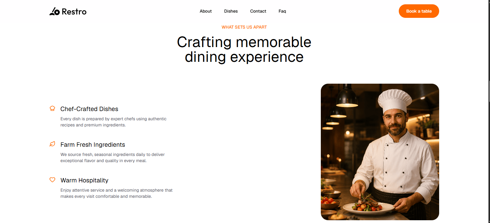
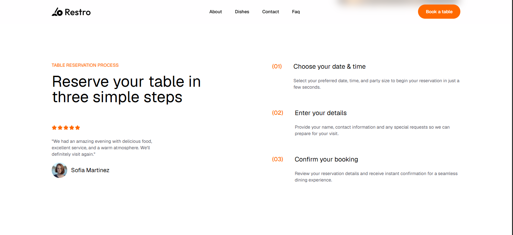
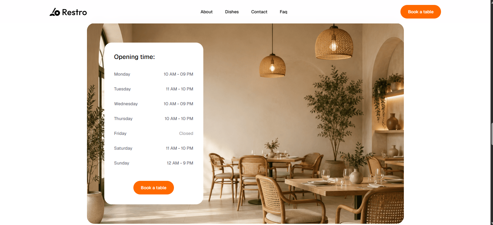
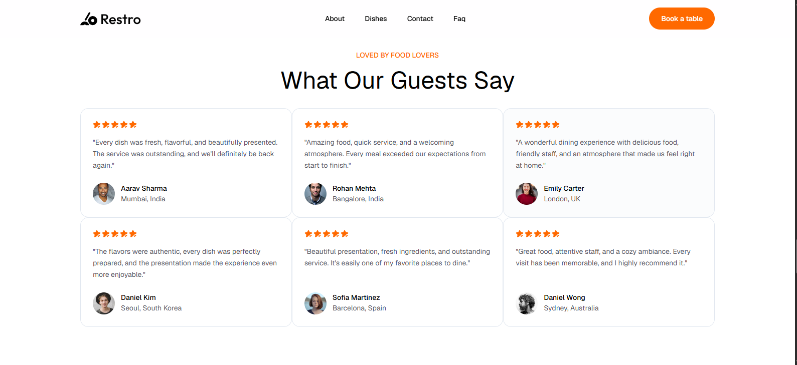
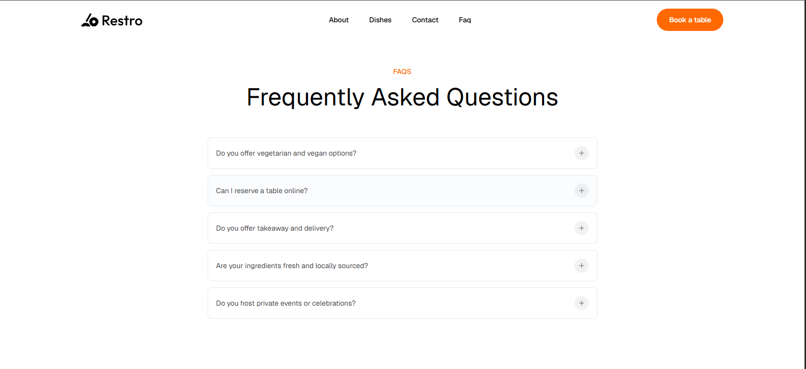
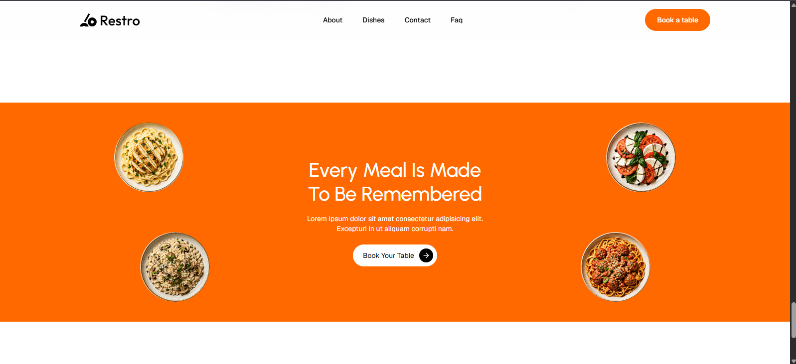
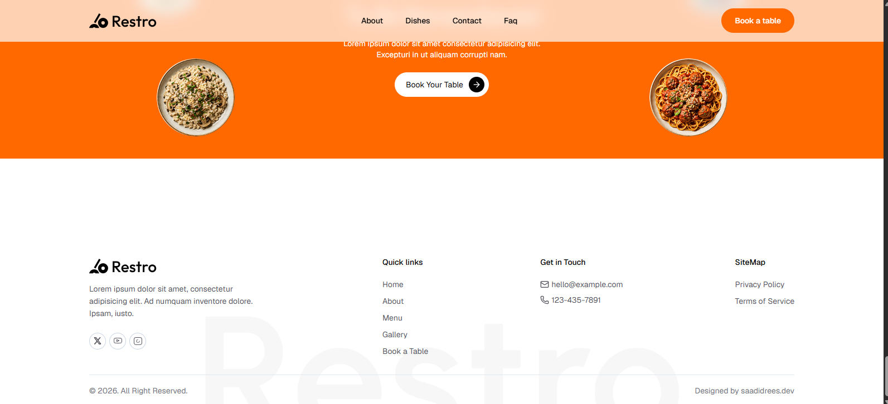

<div align="center">

# 🍽️ Restro — Restaurant Website

**A modern, fully responsive restaurant landing page with smooth scrolling and polished scroll animations.**


[Quick Start](#-getting-started) · [Screenshots](#-screenshots) · [Report Bug](../../issues) · [Request Feature](../../issues)

<br />



</div>

---

## 📖 About The Project

**Restro** is a single-page restaurant website built with **React** and **Tailwind CSS**. It guides visitors through the complete dining journey: a bold hero, the restaurant's story, signature dishes, what sets it apart, a simple booking process, opening hours, guest reviews, FAQs and a final call to action.

The design uses a clean white layout with a warm orange accent, generous spacing and rounded imagery. Buttery smooth scrolling (Lenis) and subtle entrance animations (Motion) make the page feel polished on every screen size.

> 💡 **Want to see it in action?** There is no hosted live demo yet. Just clone the repo and run it locally. It takes about a minute. See [Getting Started](#-getting-started).

---

## ✨ Features

- 📱 **Fully responsive** layout for mobile, tablet and desktop
- 🧭 **Sticky navbar** with a frosted-glass blur effect and a persistent **Book a table** call to action
- 🍔 **Mobile drawer menu** for small screens
- 🎬 **Scroll animations** powered by Motion, using a reusable `Animated` wrapper with staggered delays
- 🧈 **Smooth scrolling** with Lenis, including an anchor offset so sections never hide under the fixed navbar
- 🍝 **Signature dishes grid** with circular plates and prices
- 🗓️ **Opening hours card** overlaid on a full-width restaurant photo
- ⭐ **Testimonials grid** with ratings, avatars and guest locations
- ❓ **Accordion FAQ** with expand and collapse icons
- 🗂️ **Data-driven content** kept in a single `data.jsx` file for easy editing
- 🧩 **Clean, component-based** project structure

---

## 📸 Screenshots

<table>
  <tr>
    <td width="50%">
      
      <br /><b>About</b>
      <br /><sub>The restaurant's story, a location card and three highlights: Premium Ingredients, Chef's Expertise and Warm Hospitality.</sub>
    </td>
    <td width="50%">
      
      <br /><b>Signature Dishes</b>
      <br /><sub>A responsive grid of eight dishes, each with its name and price.</sub>
    </td>
  </tr>
  <tr>
    <td width="50%">
      
      <br /><b>What Sets Us Apart</b>
      <br /><sub>Icon-led feature list beside a chef portrait: chef-crafted dishes, farm-fresh ingredients and warm hospitality.</sub>
    </td>
    <td width="50%">
      
      <br /><b>Table Reservation Process</b>
      <br /><sub>A clear three-step booking flow with a guest review alongside.</sub>
    </td>
  </tr>
  <tr>
    <td width="50%">
      
      <br /><b>Opening Hours</b>
      <br /><sub>A weekly schedule card over an atmospheric dining-room photo, with a booking button.</sub>
    </td>
    <td width="50%">
      
      <br /><b>Guest Testimonials</b>
      <br /><sub>Six five-star reviews in a clean card grid with avatars and locations.</sub>
    </td>
  </tr>
  <tr>
    <td width="50%">
      
      <br /><b>FAQ</b>
      <br /><sub>An accordion answering common questions about dietary options, reservations, takeaway and events.</sub>
    </td>
    <td width="50%">
      
      <br /><b>Call To Action</b>
      <br /><sub>A bold orange banner with floating dish imagery and a final booking button.</sub>
    </td>
  </tr>
</table>

<div align="center">



**Footer** with brand, quick links, contact details, sitemap and social icons.

</div>

---

## 🛠️ Tech Stack

| Technology | Purpose |
| --- | --- |
| [React](https://react.dev/) | UI library |
| [Vite](https://vitejs.dev/) | Fast build tool and dev server |
| [Tailwind CSS](https://tailwindcss.com/) | Utility-first styling |
| [Motion](https://motion.dev/) | Scroll and entrance animations |
| [Lenis](https://lenis.darkroom.engineering/) | Smooth scrolling |
| [ESLint](https://eslint.org/) | Code linting |

---

## 📁 Project Structure

```
Restaurant Website
├── public/
├── screenshots/                # README preview images
├── src/
│   ├── components/
│   │   ├── Animated.jsx        # Reusable animation wrapper
│   │   ├── Footer.jsx
│   │   ├── LenisScroll.jsx     # Smooth scroll setup
│   │   └── Navbar.jsx
│   ├── data/
│   │   └── data.jsx            # Site content (links, dishes, FAQs, etc.)
│   ├── sections/
│   │   ├── About.jsx
│   │   ├── BookingProcess.jsx
│   │   ├── Cta.jsx
│   │   ├── Dishes.jsx
│   │   ├── Faq.jsx
│   │   ├── Features.jsx
│   │   ├── Herosection.jsx
│   │   ├── Stats.jsx
│   │   ├── TestimonialSection.jsx
│   │   └── Timing.jsx
│   ├── App.jsx
│   ├── App.css
│   ├── index.css
│   └── main.jsx
├── index.html
├── eslint.config.js
├── package.json
└── vite.config.js
```

---

## 🚀 Getting Started

### Prerequisites

- [Node.js](https://nodejs.org/) v18 or higher
- npm (comes with Node.js)

### Installation

1. **Clone the repository**

   ```bash
   git clone https://github.com/Saad-Idrees-dev/restro-restaurant-website.git
   ```

2. **Go into the project folder**

   ```bash
   cd restro-restaurant-website
   ```

3. **Install dependencies**

   ```bash
   npm install
   ```

4. **Start the development server**

   ```bash
   npm run dev
   ```

5. Open the local URL shown in your terminal (usually `http://localhost:5173`).

### Available Scripts

| Command | Description |
| --- | --- |
| `npm run dev` | Start the development server |
| `npm run build` | Create a production build in `dist/` |
| `npm run preview` | Preview the production build locally |
| `npm run lint` | Run ESLint |

---

## 🎨 Customization

- **Content:** edit `src/data/data.jsx` to change links, dishes, testimonials, FAQs and more.
- **Colors and styling:** everything is styled with Tailwind utility classes. Global styles live in `src/index.css`.
- **Animations:** wrap any element in the `Animated` component and pass a `delay` prop to stagger entrances.
- **Smooth scroll:** adjust duration and behavior in `src/components/LenisScroll.jsx`.

---

## 🌐 Deployment

The project can be deployed for free on [Vercel](https://vercel.com/) or [Netlify](https://www.netlify.com/):

1. Push the repository to GitHub.
2. Import it on Vercel or Netlify.
3. Use the build command `npm run build` and the output directory `dist`.

---

## 🗺️ Roadmap

- [ ] Working table reservation form with validation
- [ ] Dedicated full menu page with category filters
- [ ] Gallery page
- [ ] Hosted live demo
- [ ] Dark mode

---

## 🤝 Contributing

Contributions, issues and feature requests are welcome.

1. Fork the project
2. Create your feature branch (`git checkout -b feature/AmazingFeature`)
3. Commit your changes (`git commit -m "Add AmazingFeature"`)
4. Push to the branch (`git push origin feature/AmazingFeature`)
5. Open a Pull Request

---

## 👤 Author

**Saad Idrees**

- GitHub: [@Saad-Idrees-dev](https://github.com/Saad-Idrees-dev)

---

<div align="center">

⭐ If you like this project, please give it a star! ⭐

</div>
